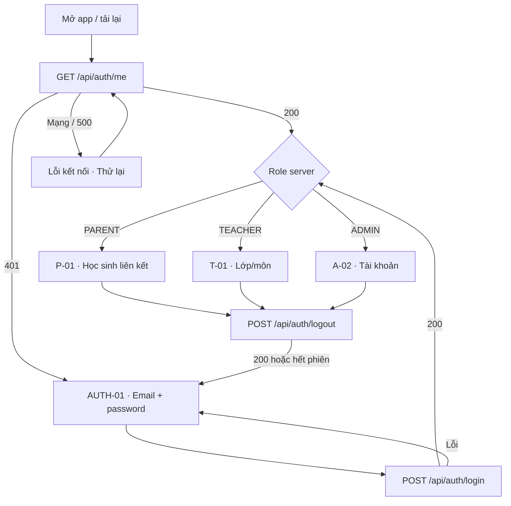
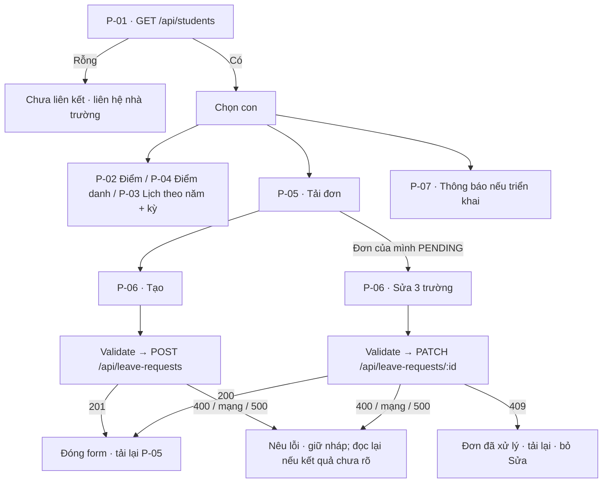
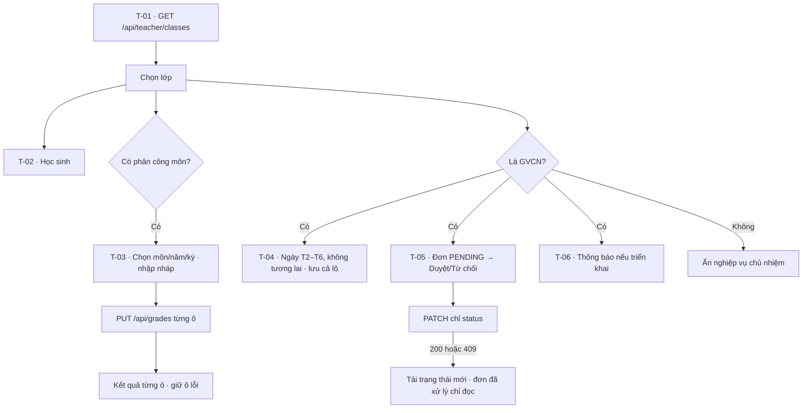
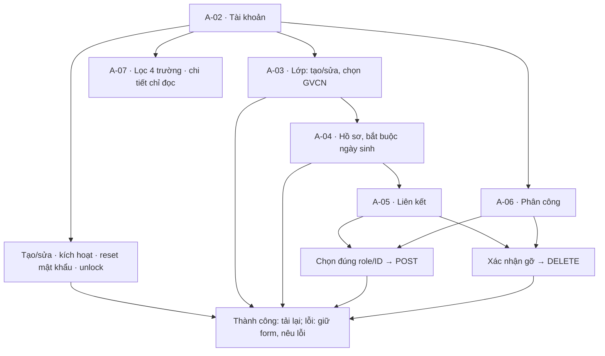

# Phần 2 — Wireframe và luồng màn hình

> Phiên bản 2.0 · 06/11/2026.
> Nguồn: `project_context_phu_huynh_nha_truong_updated.md`, cập nhật 04/11/2026; mục 3–5, 9, 12–15. Mục 15 ưu tiên hơn ví dụ cũ.
> Bàn giao lần này chỉ bằng Markdown. Mapping chi tiết: [phần 3](03-ui-api-mapping.md). HTML, JSON, MJS và prototype chưa được cập nhật theo bản này.

Đây là đặc tả để dựng giao diện, không xác nhận backend hay Figma đã triển khai. Route là route giao diện bàn giao; API đều có tiền tố `/api`.

## 1. Điều hướng và quyền

| Vai trò | Màn vào sau đăng nhập | Menu |
| --- | --- | --- |
| PARENT | P-01 · Học sinh liên kết | Học sinh, Kết quả, Điểm danh, Đơn nghỉ; Thời khóa biểu và Thông báo ở giai đoạn sau |
| TEACHER | T-01 · Lớp/môn được phân công | Lớp/môn, Học sinh, Sổ điểm; Điểm danh, Duyệt đơn và Thông báo chỉ trong lớp chủ nhiệm |
| ADMIN | A-02 · Tài khoản | Tài khoản, Lớp, Học sinh, Liên kết, Phân công, Nhật ký |

`TEACHER_HOMEROOM` là nhãn quyền theo lớp, không phải role tài khoản. Role chỉ có PARENT, TEACHER, ADMIN. Backend kiểm tra quyền từng request/đối tượng; ẩn menu không thay thế phân quyền.

Bỏ trang tổng quan admin A-01. P-01 là danh sách/hồ sơ con, T-01 là danh sách lớp/môn; không có thẻ số đếm hay thống kê tổng quan. Giữ mã các màn còn lại để đối chiếu bản cũ.

Thời khóa biểu chỉ đọc, dữ liệu seed. Thông báo làm sau chức năng bắt buộc; nếu thiếu thời gian, cắt đồng thời P-07, T-06 và mapping thông báo. Không có màn quản lý môn học/thời khóa biểu.

## 2. Khung wireframe

### 2.1. AUTH-01 · Đăng nhập

```text
ỨNG DỤNG KẾT NỐI PHỤ HUYNH VÀ NHÀ TRƯỜNG

Đăng nhập
Email       [____________________________]
Mật khẩu    [____________________] [Hiện]
[Lỗi tại trường hoặc lỗi đăng nhập]
                             [Đăng nhập]
```

- **Role:** công khai. **Route:** `/login`.
- **Dữ liệu:** nhập `email`, `password`; nhận `user.id`, `fullName`, `role` từ server. Tên hiển thị dùng `fullName`.
- **Thao tác/API:** mở app → `GET /api/auth/me`; Đăng nhập → `POST /api/auth/login`; menu Đăng xuất → `POST /api/auth/logout`.
- **Validation:** email trim, chữ thường, đúng định dạng, 5–50 ký tự; password bắt buộc, ít nhất 8 ký tự, phân biệt hoa/thường, không trim.
- **Phản hồi:** khóa nút lúc gửi, hiển thị lỗi ở trường hoặc vùng lỗi form. Không có chọn role. Hiện/ẩn mật khẩu là local.

### 2.2. Khung phụ huynh

```text
[Học sinh] [Kết quả] [Điểm danh] [Đơn nghỉ]     [Tên phụ huynh] [Đăng xuất]
Tên màn hình                     Học sinh [Chọn con đã liên kết ▾]
Họ tên · Mã học sinh · Lớp
[Bộ lọc của màn hình]
[Bảng / danh sách / hồ sơ]
[Thao tác chính nếu có]
```

### 2.3. Khung giáo viên

```text
[Lớp/môn] [Học sinh] [Sổ điểm]                 [Tên giáo viên] [Đăng xuất]
[Điểm danh] [Duyệt đơn]  ← chỉ khi có quyền chủ nhiệm lớp đang chọn
Lớp [▾]   Môn được phân công [▾]   Năm học [▾]   Học kỳ [HK1/HK2]
Học sinh             TX1          TX2          GK          CK
Mã · Họ tên          [8.25]       [   ]        [   ]       [   ]
[Lỗi của ô nếu có]                    [Hủy thay đổi] [Lưu thay đổi]
```

Bộ lọc môn/kỳ/năm chỉ hiện ở sổ điểm; điểm danh dùng ngày, duyệt đơn dùng trạng thái. Lớp chỉ chủ nhiệm vẫn xuất hiện trong T-01 với `subjectId = null`; quyền chủ nhiệm không cấp quyền nhập điểm môn chưa được phân công.

### 2.4. Khung admin

```text
[Tài khoản] [Lớp] [Học sinh] [Liên kết] [Phân công] [Nhật ký] [Đăng xuất]
Tên màn hình                                            [Thêm / Tạo]
[Tìm kiếm / bộ lọc được API hỗ trợ]
[Bảng danh sách] [Sửa / thao tác theo dòng]

Form tạo/sửa: [Các trường] → [Lỗi] → [Hủy] [Lưu]
Gỡ liên kết/phân công: nêu rõ đối tượng → [Hủy] [Xác nhận gỡ]
```

Admin không có menu xem điểm, điểm danh, đơn nghỉ hay dữ liệu học tập. Ngoại lệ đã chốt: audit log có thể chứa giá trị điểm cũ/mới; quyền xem log không cấp quyền xem bảng điểm.

## 3. Màn hình phụ huynh

Mọi màn P-* yêu cầu `PARENT`. Chỉ dùng học sinh từ `GET /api/students`; thông báo dùng `class.id` của con. Đổi học sinh phải bỏ ngữ cảnh cũ và response đến muộn.

| Mã · route | Bố trí và dữ liệu hiển thị | Thao tác → API |
| --- | --- | --- |
| **P-01 · Học sinh liên kết**<br>`/parent/students` | Danh sách con → hồ sơ con được chọn: `id`, `studentCode`, `fullName`, `dateOfBirth`, `class.{id,name,classCode,schoolYear}`. Không có thống kê. | Mở → `GET /api/students`. Chọn con/Xem kết quả → P-02; các menu khác mang theo con đang chọn. |
| **P-02 · Kết quả**<br>`/parent/grades` | Lọc `schoolYear`, `term`, môn nếu cần → bảng Môn, TX1, TX2, GK, CK. Điểm có `id`, `subject.{id,name}`, `scoreType`, `score`, `term`, `schoolYear`. Chưa có điểm là `—`, điểm 0 vẫn hiện 0. Không tính điểm trung bình. | Mở/đổi con, năm, kỳ, môn → `GET /api/students/:id/grades`. Danh mục môn lọc từ dữ liệu đã tải; phụ huynh không gọi `/api/subjects`. |
| **P-03 · Thời khóa biểu**<br>`/parent/timetable`<br>Giai đoạn sau | Lọc `schoolYear`, `term` → bảng cột Thứ Hai–Thứ Sáu (`weekday` 2–6), hàng tiết 1–12, ô là môn. `room` chỉ hiện nếu response có. Lịch cố định theo thứ/tiết. | Mở/đổi con, năm, kỳ → `GET /api/students/:id/timetable`. Không chọn tuần trước/sau, không gửi weekStart, không tự gán giờ tiết/tên giáo viên. |
| **P-04 · Lịch sử điểm danh**<br>`/parent/attendance` | Chọn tháng → bảng Ngày, Thứ, Trạng thái; dữ liệu `date`, `status`. Tháng chuyển thành khoảng `from`, `to`. Không có ghi chú. Ngày thiếu bản ghi là “Chưa ghi nhận”. | Mở/đổi tháng, con → `GET /api/students/:id/attendance?from=…&to=…`. |
| **P-05 · Đơn xin nghỉ**<br>`/parent/leave-requests` | Tạo đơn → lọc trạng thái → danh sách `id`, `fromDate`, `toDate`, `reason`, `status`, `createdAt`; chi tiết dùng dòng đã tải. Chỉ đơn của mình còn PENDING có Sửa. | Mở/lọc → `GET /api/students/:id/leave-requests`. Tạo/Sửa mở P-06; không có xóa đơn. |
| **P-06 · Tạo / sửa đơn**<br>Modal trên P-05 | Tiêu đề theo chế độ → học sinh chỉ đọc → `fromDate`, `toDate`, `reason` → lỗi → Hủy / Gửi đơn hoặc Lưu thay đổi. Sửa điền dữ liệu đơn đã chọn, không đổi học sinh. | Tạo → `POST /api/leave-requests`, `{studentId,fromDate,toDate,reason}`. Sửa → `PATCH /api/leave-requests/:id`, chỉ `{fromDate,toDate,reason}`. Thành công đóng form, tải P-05; 409: báo đơn đã xử lý, tải lại và bỏ quyền sửa. |
| **P-07 · Thông báo lớp**<br>`/parent/announcements`<br>Tùy tiến độ | Danh sách `id`, `title`, `createdAt` → mở `content` đã tải. | Mở/đổi sang con khác lớp → `GET /api/classes/:id/announcements`. Đóng/mở chi tiết là local, không có API đánh dấu đã đọc. |

**P-06 (§15.5):** ngày hợp lệ YYYY-MM-DD, `toDate >= fromDate`; khi tạo, `fromDate` không quá khứ. Lý do bắt buộc, trim, 10–500 ký tự, có bộ đếm. Sửa chỉ khi PENDING; backend xác minh người tạo và liên kết. Không gửi parentId/status/reviewedBy/reviewedAt từ form phụ huynh. Ở form sửa, bộ chọn ngày bắt đầu chỉ chặn quá khứ khi người dùng đổi ngày. Nếu đơn đã quá hạn mà ngày giữ nguyên thì vẫn hiển thị bình thường, không báo lỗi.

Không có con liên kết: P-01 hiện “Chưa có học sinh liên kết. Vui lòng liên hệ nhà trường”; không gọi API chi tiết và không mở form gửi đơn.

## 4. Màn hình giáo viên

| Mã · role · route | Bố trí và dữ liệu hiển thị | Thao tác → API |
| --- | --- | --- |
| **T-01 · Lớp/môn được phân công**<br>TEACHER<br>`/teacher/classes` | `classId`, `className`, `subjectId`, `subjectName`, `isHomeroom`; gộp theo lớp, giữ danh sách môn và nhãn Chủ nhiệm. Không có thống kê. Dòng chỉ chủ nhiệm: subjectId/subjectName null, isHomeroom true. | Mở/làm mới → `GET /api/teacher/classes`. Chọn lớp → T-02; có môn dạy → T-03; là GVCN → T-04/T-05/T-06. Rỗng: “Chưa được phân công”. |
| **T-02 · Học sinh**<br>TEACHER là GVCN hoặc được phân công ở lớp<br>`/teacher/students` | Chọn lớp → bảng `id`, `studentCode`, `fullName`; tìm tên/mã local. | Chọn lớp → `GET /api/classes/:id/students`. Mở sổ điểm chỉ khi có môn được phân công; không gọi API hồ sơ admin. |
| **T-03 · Sổ điểm**<br>TEACHER đúng phân công lớp/môn<br>`/teacher/grades` | Chọn lớp, môn, năm, kỳ → roster và cột TX1/TX2/GK/CK → Hủy/Lưu. Dữ liệu `studentId`, `studentName`, `grades[]`; ô dùng scoreType/score, xem lưu ý field ở phần 3. | Roster → `GET /api/classes/:id/students`; điểm → `GET /api/classes/:id/grades?subjectId=…&term=…&schoolYear=…`; Lưu → mỗi ô một `PUT /api/grades`. Không xóa điểm. |
| **T-04 · Điểm danh**<br>TEACHER_HOMEROOM<br>`/teacher/attendance` | Chọn lớp chủ nhiệm, ngày → học sinh, trạng thái → Chọn tất cả có mặt / Lưu. Dữ liệu date/studentId/studentName/status, không ghi chú. Chưa có bản ghi thì trạng thái chưa chọn. | Roster → `GET /api/classes/:id/students`; ngày → `GET /api/classes/:id/attendance?date=…`; Lưu → `PUT /api/classes/:id/attendance`, `{date,items:[{studentId,status}]}`. Chọn tất cả chỉ điền nháp. |
| **T-05 · Duyệt đơn**<br>TEACHER_HOMEROOM<br>`/teacher/leave-requests` | Lọc trạng thái, mặc định PENDING → bảng id/studentId/studentName/fromDate/toDate/reason/status → chi tiết → Duyệt/Từ chối. Không có ghi chú duyệt. | Tải/lọc → `GET /api/classes/:id/leave-requests`. Xác nhận → `PATCH /api/leave-requests/:id`, chỉ `{status:"APPROVED"}` hoặc `{status:"REJECTED"}`. 409 tải lại trạng thái, chuyển chỉ đọc. |
| **T-06 · Thông báo**<br>TEACHER_HOMEROOM<br>`/teacher/announcements`<br>Tùy tiến độ | Danh sách id/title/content/createdAt → Đăng thông báo → form lớp chỉ đọc, title, content, Hủy/Đăng. Không sửa/xóa. | Tải → `GET /api/classes/:id/announcements`, quyền GVCN đã có; đăng → `POST /api/classes/:id/announcements`, `{title,content}`. |

- **T-03:** số 0–10, tối đa 2 chữ số thập phân; scoreType TX1/TX2/GK/CK, term HK1/HK2. Body PUT gửi số trong field `score` đúng §13.3. Ô trống chưa nhập không gửi; xóa trắng điểm cũ không được hiểu là xóa bản ghi. Lưu nhiều ô không nguyên tử: đánh dấu kết quả từng ô, giữ ô lỗi/chưa gửi. Backend ghi mỗi điểm và audit log trong cùng transaction.
- **T-04:** chặn thứ Bảy, Chủ nhật và ngày tương lai ở bộ chọn lẫn lúc gửi; chỉ thứ Hai–thứ Sáu, được bù quá khứ. Backend kiểm tra ngày, GVCN, mọi studentId thuộc lớp; validate toàn bộ lô trước ghi, một dòng sai không lưu dở dang. Bù quá khứ vẫn ghi created_at và audit log.
- **T-05:** GVCN xử lý đơn PENDING bất cứ lúc nào; không tự đặt deadline/tự từ chối. Reviewer/time do server ghi.
- **T-06:** title trim 5–50, content trim 10–1000 ký tự, bắt buộc cả hai, có bộ đếm. Lớp là lớp chủ nhiệm; tác giả từ session.

## 5. Màn hình admin

Tất cả A-* chỉ `ADMIN`. Lookup từ API quản trị sẵn có, ghép nhãn bằng ID; không dùng API học tập để lấy tên học sinh.

| Mã · route | Bố trí và dữ liệu hiển thị | Thao tác → API |
| --- | --- | --- |
| **A-02 · Tài khoản**<br>`/admin/users` | Tìm kiếm, lọc role → bảng id/email/fullName/role/isActive → Tạo / Sửa / Kích hoạt–Vô hiệu hóa / Đặt lại mật khẩu / Mở khóa. Tạo: fullName, email, password, role PARENT/TEACHER. Sửa: fullName, isActive. Reset dùng form mật khẩu mới. | Đọc → `GET /api/admin/users`; tạo → `POST /api/admin/users`; sửa/trạng thái → `PATCH /api/admin/users/:id` với fullName/isActive thay đổi; reset → cùng PATCH, `{password}`; unlock → cùng PATCH, `{unlock:true}`. Không xóa cứng. |
| **A-03 · Lớp**<br>`/admin/classes` | Tìm → bảng id/name/schoolYear/homeroomTeacherId và tên GVCN → Tạo/Sửa. Form name, **classCode**, schoolYear, homeroomTeacherId đều bắt buộc. | Đọc → `GET /api/admin/classes`; picker → `GET /api/admin/users?role=TEACHER`; tạo → `POST /api/admin/classes`; sửa → `PATCH /api/admin/classes/:id` theo allowlist backend. Không xóa lớp. |
| **A-04 · Hồ sơ học sinh**<br>`/admin/students` | Tìm/lọc lớp → bảng id/studentCode/fullName/**dateOfBirth**/classId → Tạo/Sửa. Form mã, tên, ngày sinh, lớp; không ẩn ngày sinh. | Đọc → `GET /api/admin/students`; picker → `GET /api/admin/classes`; tạo → `POST /api/admin/students`, `{studentCode,fullName,dateOfBirth,classId}`; sửa → `PATCH /api/admin/students/:id` sửa hết trừ id và studentCode. Không gắn quy tắc chuyển lớp/lịch sử chưa có trong context. |
| **A-05 · Liên kết**<br>`/admin/parent-students` | Lọc parentId/studentId → bảng parentId/studentId/relationship cùng tên ghép → Tạo/Gỡ. Form parent PARENT, học sinh, Quan hệ dropdown **PARENT / GUARDIAN**, không nhập tự do. | Đọc → `GET /api/admin/parent-students`; picker → `GET /api/admin/users?role=PARENT`, `GET /api/admin/students`; tạo → `POST /api/admin/parent-students`; gỡ → `DELETE /api/admin/parent-students/:parentId/:studentId`. Tạo/gỡ ghi audit. |
| **A-06 · Phân công**<br>`/admin/teaching-assignments` | Lọc classId/teacherId → bảng teacherId/classId/subjectId cùng tên ghép → Tạo/Gỡ. Form giáo viên TEACHER, lớp, môn seed. Chủ nhiệm chọn ở A-03, không tạo teaching assignment môn null. | Đọc → `GET /api/admin/teaching-assignments`; picker → `GET /api/admin/users?role=TEACHER`, `GET /api/admin/classes`, **`GET /api/subjects`**; tạo → `POST /api/admin/teaching-assignments`; gỡ → `DELETE /api/admin/teaching-assignments/:teacherId/:classId/:subjectId`. Tạo/gỡ ghi audit. |
| **A-07 · Audit log**<br>`/admin/audit-logs` | Lọc đủ **studentId, action, entityType, entityId** → bảng id/actorId/action/entityType/entityId/createdAt → oldValue/newValue chỉ đọc. Chưa phân trang/xuất file. | Lọc → `GET /api/admin/audit-logs` với query tương ứng. Chi tiết local từ dòng đã tải; không sửa/xóa log. |

**Validation form admin:**

| Form | Quy tắc |
| --- | --- |
| A-02 | fullName trim 5–50, cho chữ Việt, dấu cách, gạch nối. Email trim + lowercase, đúng định dạng, 5–50, duy nhất. Password ít nhất 8, không trim; áp dụng cả tạo/reset. isActive là bật/tắt ở UI, API boolean như §13.4, DB 0/1. PATCH allowlist fullName/isActive/password/unlock, không tự cho đổi email/role. Unlock xóa failed_logins/locked_until, khác kích hoạt; không suy ra bị khóa từ isActive. |
| A-03 | Tên lớp 2–20, classCode 2–10; schoolYear YYYY-YYYY. GVCN bắt buộc TEACHER, tối đa một lớp/năm. Cặp classCode + schoolYear duy nhất. |
| A-04 | studentCode TEXT bắt buộc/duy nhất, mẫu Niên khóa-lớp-firstName-stt: `12-10A1-An-01`, tên trong mã bỏ dấu. fullName trim 5–50; dateOfBirth bắt buộc, ngày thật YYYY-MM-DD, không tương lai; classId bắt buộc và tồn tại. Không tự sinh niên khóa/số thứ tự chưa có dữ liệu trường. |
| A-05 | Ba trường bắt buộc; đúng role parent, học sinh tồn tại; mỗi học sinh chỉ có một phụ huynh. Nhãn PARENT = Phụ huynh, GUARDIAN = Người giám hộ; không gửi Bố/Mẹ. |
| A-06 | Ba ID bắt buộc; teacher TEACHER; lớp/môn tồn tại; cặp lớp–môn duy nhất. Môn chỉ đọc, không CRUD. |
| A-07 | studentId hợp lệ nếu dùng; action CREATE/UPDATE/DELETE; entityType chọn tên bảng §15.6, liệt kê ở phần 3; entityId TEXT tự nhập, không phải enum. Bỏ query rỗng. |

## 6. Luồng màn hình

### 6.1. Xác thực



### 6.2. Phụ huynh: tạo và sửa đơn



### 6.3. Giáo viên



### 6.4. Admin



Mũi tên admin mô tả phụ thuộc dữ liệu; mọi màn đều mở trực tiếp từ menu, không bắt buộc đi qua toàn bộ luồng.

## 7. Trạng thái và bố cục tối thiểu

- Loading ngay tại vùng liên quan; khóa gửi lặp, giữ nháp nếu lỗi. GET rỗng hiện “Chưa có dữ liệu”, không thay bằng dữ liệu demo.
- 400: lỗi trường/form; 401: về login, xóa dữ liệu riêng tư; 403/404: bỏ dữ liệu không còn được phép; 409: báo trùng/xung đột, tải trạng thái mới khi cần. Mạng/500 có Thử lại; ghi bị timeout cần đọc lại trước gửi lại.
- Hủy/đóng/điều hướng/nhập nháp không ghi; cảnh báo bỏ nháp nếu đã thay đổi. Chi tiết đơn/thông báo/log lấy từ danh sách, không tự thêm API.
- Desktop menu và bảng/form rõ ràng; điện thoại menu thu gọn, form một cột, bảng rộng cuộn ngang. Có nhãn, dấu bắt buộc, lỗi gần trường và nút chính dễ thấy.
- Ngày nghiệp vụ YYYY-MM-DD, không đổi múi giờ; thứ tính từ ngày thật. Timestamp UTC hiển thị giờ Việt Nam.

Những field/allowlist nguồn còn chưa liệt kê đủ được ghi ngắn ở cuối phần 3; không xem API đã có là đề xuất bổ sung.
